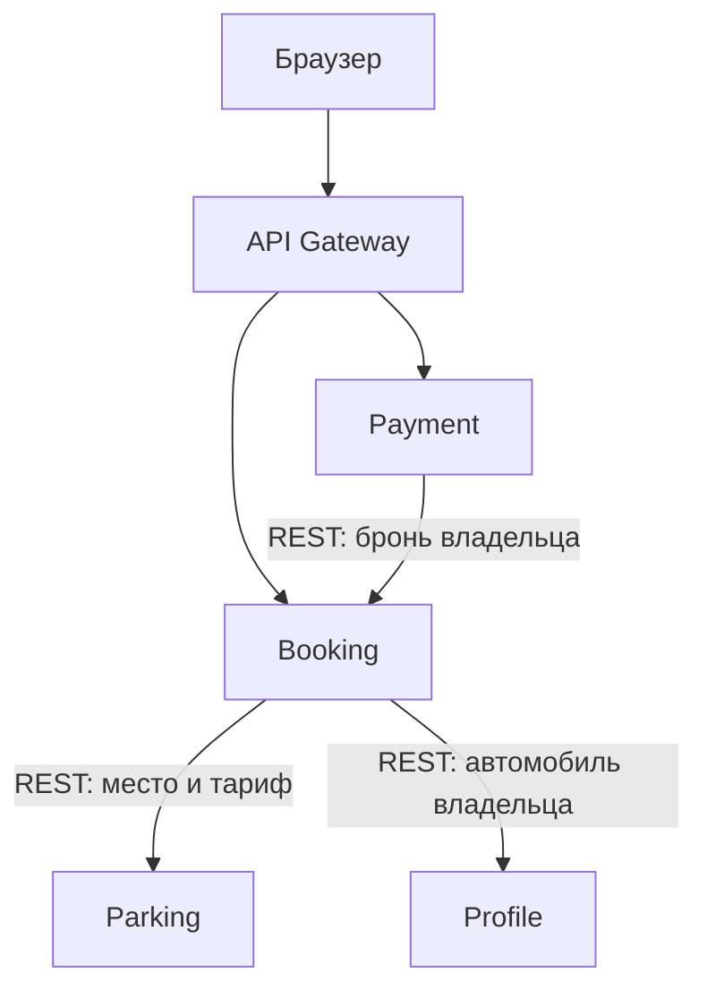
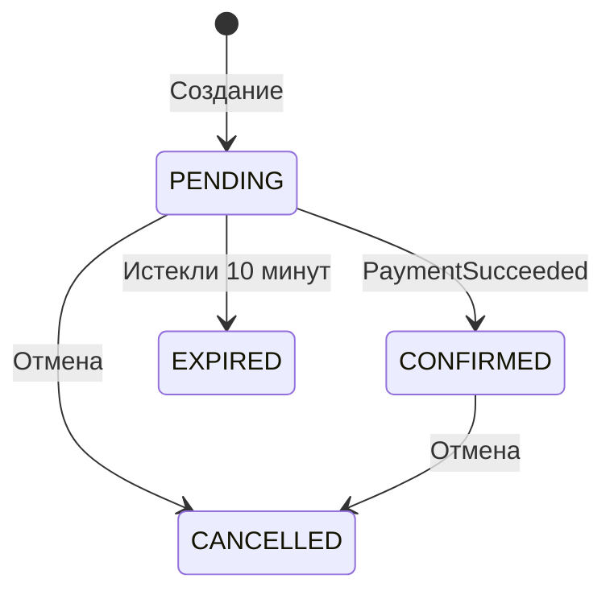
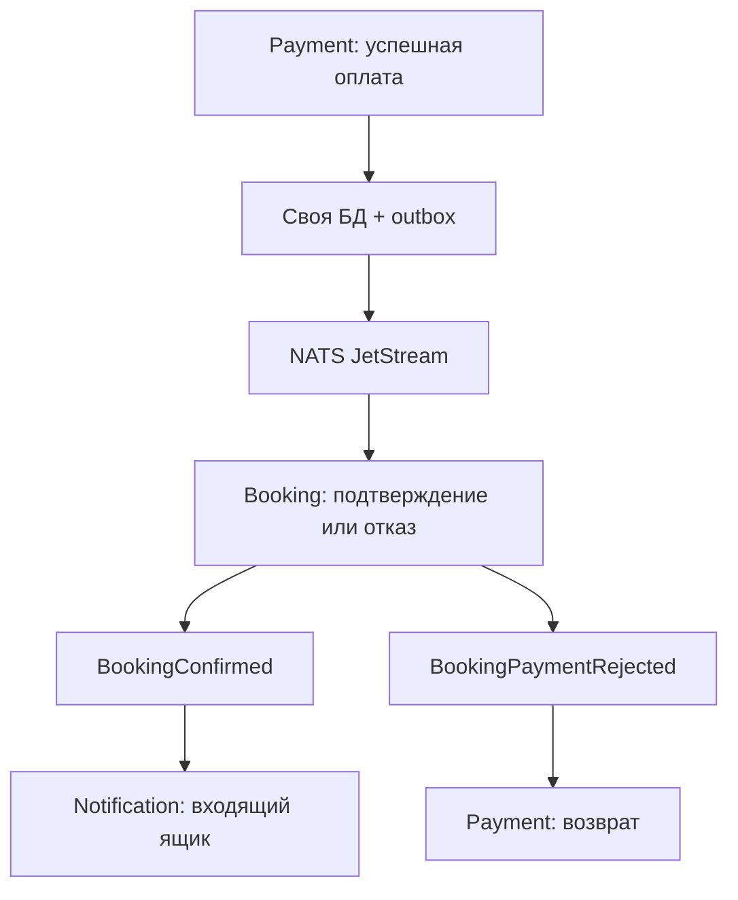

# Архитектура ParkSlot

## 1. Границы сервисов

Единица развёртывания - отдельное приложение FastAPI в собственном процессе/контейнере. Единой backend-программы, которая вызывает бизнес-модули через Python import, нет. Общий пакет содержит инфраструктуру и не импортирует код предметной области.

Auth хранит только учётные записи и сведения для входа. Profile владеет контактами, автомобилями и пользовательскими настройками. Parking владеет справочником физической структуры парковок и текущими тарифами. Booking владеет резервированием времени и ценой конкретной брони. Payment владеет платёжным состоянием. Notification владеет пользовательским входящим ящиком.

Одна авторизационная учётная запись и один профиль связаны `user_id`, но являются разными сущностями и находятся в разных БД. Сервис не выполняет JOIN или SQL-запросы к чужому хранилищу.

Внешние порты опубликованы только на `127.0.0.1`. Gateway предоставляет единый адрес для UI и API. Дополнительные порты сервисов нужны для учебной проверки их независимости, health checks и прямой документации.

## 2. Хранение и конкурентный доступ

У каждого сервиса свой файл SQLite `/data/service.db`, подключённый через **разный именованный Docker volume**. Совпадение имени файла внутри разных контейнеров не означает общую БД. NATS имеет собственный том.

Выбор SQLite обусловлен одним ПК и одним экземпляром каждого сервиса, небольшим объёмом данных и отсутствием необходимости администрировать отдельные серверы БД. Используются внешние ключи, WAL, параметризованные запросы, транзакции и ограниченное ожидание блокировки.

Для Booking критическая секция начинается с `BEGIN IMMEDIATE`: проверка пересечения и вставка новой брони выполняются под одной блокировкой записи. Условие пересечения: существующее начало меньше нового окончания, существующее окончание больше нового начала. Это допускает соседние интервалы без пересечения.

Гарантия действует при единственном хранилище Booking. Создание второй независимой копии его файла не является масштабированием. Для нескольких экземпляров Booking нужно заменить его хранилище на БД, поддерживающую общий конкурентный доступ, и перенести ограничение пересечений на соответствующий механизм БД.

Суммы хранятся целыми банами, время - в едином формате UTC. Цена вычисляется на сервере и сохраняется в брони. Изменение справочного тарифа не изменяет старую бронь.

## 3. Состояния и согласованность

Терминальные состояния `CANCELLED` и `EXPIRED` не подтверждаются запоздавшим платежом. Booking публикует `BookingPaymentRejected`; Payment выполняет компенсацию возвратом.

Payment имеет состояния `SUCCEEDED`, `DECLINED`, `REFUNDED`. Отклонённая попытка не запрещает новую попытку с новым ключом. Частичный уникальный индекс разрешает максимум один успешный платёж на бронь. Повтор запроса с тем же ключом возвращает прежний результат; повторное использование ключа для другого тела отклоняется.

Распределённой SQL-транзакции между Booking и Payment нет. В момент принятой оплаты бронь может ещё иметь состояние `PENDING`. Согласование происходит через события, при конфликте выполняется возврат. Интерфейс не объявляет бронь подтверждённой на основании одного HTTP-ответа Payment.

## 4. События и гарантии

Изменение бизнес-данных и запись в outbox фиксируются одной локальной транзакцией. Фоновый обработчик публикует события в сохраняемый поток `PARKING`. Отметка публикации ставится после подтверждения JetStream.

Каждый сервис имеет собственного durable consumer. Мутация при обработке события и запись `event_id` в inbox выполняются одной транзакцией. ACK отправляется после фиксации. Повторная доставка уже обработанного ID не повторяет эффект.

Сбой после публикации, но до отметки outbox может вызвать повторную публикацию. Поэтому предусмотрены как `Nats-Msg-Id`, так и постоянный inbox получателя. Это **доставка как минимум один раз с идемпотентной обработкой**, не обещание глобальной доставки строго один раз.

Обработчики подтверждают неподдерживаемые типы событий без бизнес-мутаций. Для учебного объёма все потребители подписаны на `parking.events.>`; каждый обрабатывает только свои типы. В более крупной системе следует использовать отдельные фильтры и права на subjects.

При ошибке обработчика сообщение повторяется. После семи неудачных обработок записывается в локальную таблицу `failed_events`, доставка прекращается. Это карантин для ручной диагностики; автоматический интерфейс повторного запуска таких сообщений в первой версии не реализован.

Поток ограничен семью днями и 128 MiB. Если получатель не работает дольше срока хранения или достигнут предел, вечная доставка не гарантируется. Очередь рассчитана на локальную учебную демонстрацию. Настройки лимитов указаны в `parking_common/events.py` и `infrastructure/nats.conf`.

Профиль создаётся по событию регистрации. Для немедленного первого обращения предусмотрено идемпотентное создание по данным проверенного JWT. Настройки уведомлений доставляются отдельным событием и применяются после его обработки.

## 5. Авторизация и конфигурация

Auth подписывает JWT алгоритмом EdDSA, используя отдельный закрытый ключ. Другие сервисы получают публичный ключ и проверяют подпись локально. Проверяются `exp`, `iat`, `iss`, `aud`, `sub` и роль. Срок токена - два часа. Gateway не подменяет проверку прав в бизнес-сервисах.

Роли: `user`, `admin`. Пользователь видит свои автомобили, брони, платежи и уведомления. Для чужих объектов возвращается 404. Администратор управляет парковками, просматривает все брони/платежи и может отменять брони через API. При регистрации роль от клиента не принимается.

Пароли хешируются scrypt с индивидуальной случайной солью. После восьми неудачных входов включается минутная блокировка для адреса. Gateway дополнительно ограничивает запросы входа/регистрации по адресу клиента. Токен находится в памяти вкладки/sessionStorage и удаляется при выходе. Серверного отзыва токена и сброса пароля в учебной версии нет.

`.env` генерируется отдельно для каждой установки. Закрытый JWT-ключ и пароль администратора передаются только Auth. Запросы от имени пользователя передают его JWT. Команды календаря, резервирование промокода и импорт отчётов используют `INTERNAL_API_KEY`. Эти внутренние маршруты требуют ключа, не публикуются в Swagger и не маршрутизируются через Gateway.

## 6. Ошибки, логи и готовность

Проверяются входные данные, принадлежность ресурсов и допустимость переходов состояния. Ошибки зависимостей имеют конечное ожидание и возвращаются как 503/504. Ошибки БД обрабатываются без передачи stack trace клиенту. Валидационные ответы не возвращают исходный пароль.

Каждый запрос имеет Request ID. Он передаётся через REST и помещается в события. JSON-логи содержат время, сервис, уровень, Request ID и сообщение; HTTP-записи также содержат метод, путь, статус и время обработки. Пароли, токены и тела запросов не логируются. Системные сообщения запуска Uvicorn/NATS имеют собственный формат; прикладные логи сервисов структурированы.

`/health` сообщает, что процесс обслуживает HTTP. `/ready` дополнительно проверяет БД и соединение с брокером. Готовность не означает готовность всех соседних сервисов: их недоступность обнаруживается при конкретном REST-вызове. Gateway агрегирует готовность десяти сервисов.

## 7. Расширение версии 1.1

Promotion владеет правилами скидок и учётом применений. Waitlist владеет очередью и предложениями. Maintenance владеет планом работ, Booking владеет общим календарём занятости и хранит блокировки в своей БД. Reporting владеет проекциями данных для отчётов и обновляет их по событиям. Подробные сценарии: [расширение ParkSlot](expansion.md).

Даже при временно недоступном брокере сервис может сохранить новую операцию и outbox. Его `/ready` при этом возвращает 503. После восстановления брокера очередь outbox обрабатывается. Независимость запуска означает самостоятельный процесс и собственные зависимости; успешная оплата всё равно требует доступного Booking.
