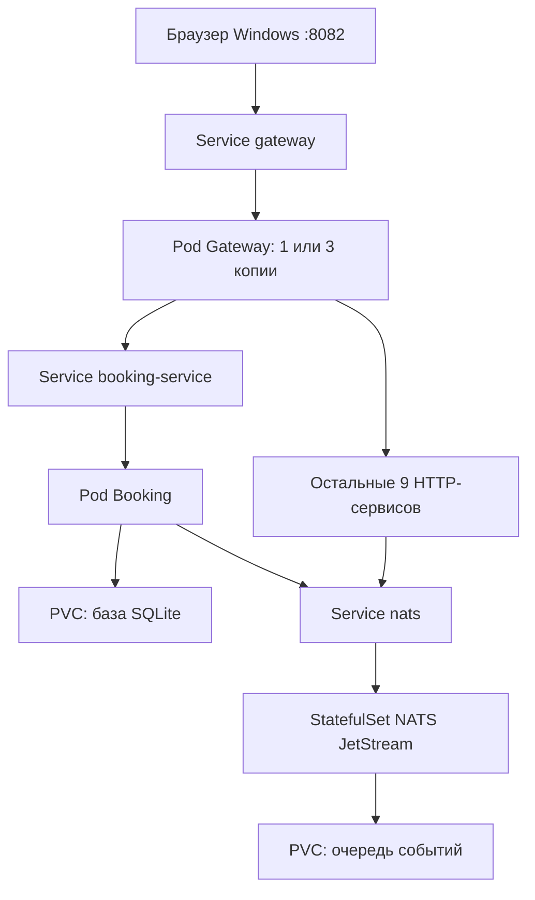

# Защита лабораторной №3

Перед защитой запустите `start-k8s.bat`, затем `open-k8s.bat`. Можно выполнить `verify-k8s.bat` и объяснять вывод по шагам или показать команды вручную. После проверки остаются три запущенных Gateway и учебная бронь.

## 1. ПО и схема

**Docker** собирает образ: в нём код сервиса, Python и зависимости. **Контейнер** — запущенный экземпляр образа. **Compose** поднимает все контейнеры на одном Docker Engine. **Kubernetes** поддерживает заданное количество Pod’ов и направляет запросы в готовые экземпляры. **Minikube** запускает учебный Kubernetes на одном ПК.

**Deployment** описывает шаблон Pod’а, образ и количество экземпляров. **Service** даёт постоянное имя, хотя Pod’ы могут меняться. **ConfigMap** хранит настройки, **Secret** — учётные данные. **PVC** запрашивает постоянный том. Логи идут в стандартный вывод контейнера, откуда их читает `kubectl logs`.



Путь из Windows открывает `kubectl port-forward`; в схеме Service gateway выбирает подходящий Pod для этого сеанса. Для проверки балансировки обращайтесь к адресу `http://gateway:8000` **изнутри** кластера. Port-forward остаётся привязанным к одному Pod’у и не показывает распределение запросов.

## 2. Команды и ожидаемые результаты

Команды ниже рассчитаны на PowerShell. Функция `k` всегда работает только с учебным кластером и namespace:

```powershell
function k { kubectl --context parkslot-lab3 -n parkslot @args }
k get pods -o wide
k get services
k get deployments
k get statefulsets
k get pvc
k get configmaps
k get secrets
```

До масштабирования должно быть **12 Pod’ов** приложения: 10 бизнес-сервисов, Gateway и NATS. У приложения 11 Deployment и один StatefulSet. **13 Service** включают 10 внутренних API, Gateway и два Service NATS: обычный для клиентов и headless для стабильного имени Pod’а StatefulSet. Должно быть 11 PVC в состоянии `Bound`, два ConfigMap и два Secret приложения. Не выводите значения Secret на экран при демонстрации.

Для показа структуры одного сервиса:

```powershell
Get-Content .\services\booking-service\Dockerfile
Get-Content .\k8s\deployments\booking-service.yaml
Get-Content .\k8s\services\booking-service.yaml
k describe deployment booking-service
k logs deployment/booking-service --tail=20
```

Покажите `image`, `replicas`, порт 8000, `envFrom`, `requests` и `limits`, `startupProbe`, `livenessProbe` и `readinessProbe`. У Service селектор `app: booking-service` совпадает с меткой Pod’а. Каждый бизнес-сервис получает DNS-имена остальных из `parkslot-runtime`.

### Работа API и логов

```powershell
$baseUrl = 'http://127.0.0.1:8082'
Invoke-RestMethod "$baseUrl/api/status"
Invoke-RestMethod "$baseUrl/api/parking/lots" -Headers @{'X-Request-ID'='lab3-demo-lots'} |
    Select-Object name, active_spaces, hourly_rate_cents
Invoke-RestMethod "$baseUrl/api/ready/booking"
k logs deployment/parking-service --tail=50 | Select-String 'lab3-demo-lots'
```

Ожидается `ready: true`, каталог парковок и запись с тем же Request ID в логе Parking. В интерфейсе или Swagger можно зарегистрировать пользователя, добавить машину и оформить бронь. `verify-k8s.bat` создаёт парковку с ценой 30 MDL, применяет `PARK10`, оплачивает 27 MDL и ждёт `CONFIRMED`. Это проверяет цепочку REST между Auth, Profile, Parking, Booking, Promotion и Payment, затем подтверждение брони через JetStream. Подробные запросы — в [справке API](api.md).

### Масштабирование и распределение запросов

```powershell
k scale deployment/gateway --replicas=3
k rollout status deployment/gateway --timeout=180s
k get pods -l app=gateway -o wide
k get endpointslices -l kubernetes.io/service-name=gateway -o wide
$code = 'from collections import Counter; from urllib.request import urlopen; print(dict(Counter(urlopen("http://gateway:8000/health",timeout=5).headers["X-ParkSlot-Instance"] for i in range(48))))'
$code | k exec -i deployment/gateway -- python -
```

Ожидаются три готовых Gateway и три разных имени Pod’ов в ответах. Количество запросов на экземпляр может отличаться. В каждой копии Gateway одинаковая маршрутизация; бизнес-данные остаются у соответствующих сервисов. SQLite-сервисы в этой работе сохраняют одну реплику: `ReadWriteOnce` ограничивает узел, но не гарантирует эксклюзивное использование одним Pod’ом. Масштабирование сервисов с данными потребовало бы отдельной серверной БД и координации фоновых задач.

### Восстановление

Сохраните ID любой брони в интерфейсе или используйте ID, который вывел `verify-k8s.bat`. Затем:

```powershell
$oldBookingPod = k get pod -l app=booking-service -o name
$oldBookingPod
k delete $oldBookingPod --wait=true --timeout=100s
k wait --for=condition=Ready pod -l app=booking-service --timeout=160s
k get pods -l app=booking-service -o wide
k get pvc booking-data
```

У нового Pod’а будет другое имя, а подключённый `booking-data` останется тем же. Дождитесь `ready: true` и откройте прежнюю бронь; ожидается тот же ID и статус. Если демонстрируете удаление самого Gateway, сеанс port-forward может закрыться — снова запустите `open-k8s.bat`.

Чтобы вернуть одну реплику, закройте окно port-forward, выполните `k scale deployment/gateway --replicas=1`, дождитесь `k rollout status deployment/gateway`, затем снова откройте порт. Это не затрагивает данные.

## 3. Критерии оценивания

| Критерий | Вес | Что показать |
|---|---:|---|
| Dockerfile | 15% | 10 файлов в `services/*/`, slim-образ, кешируемый слой зависимостей, UID 10001, `Dockerfile.dockerignore` |
| Docker Compose | 10% | `docker compose ps` после `start.bat`, запрос к `:8081/api/status` |
| Kubernetes Deployments | 20% | Десять бизнес-Deployment и Gateway; образ, реплика и порт в YAML |
| Kubernetes Services | 15% | `k get services`, DNS в ConfigMap, работа запроса из кластера |
| ConfigMap / Secrets | 10% | `k get configmaps`, `k get secrets`, ссылки `envFrom` и `secretKeyRef` |
| Health checks | 10% | `/health`, `/ready`, три probe у Deployment и готовые Pod’ы |
| Resource limits | 5% | Requests и limits в Deployment |
| Масштабирование | 5% | 1 → 3 экземпляра Gateway, разные `X-ParkSlot-Instance` |
| Демонстрация и документация | 10% | Реальная бронь, оплата, логи, замена Pod’а с сохранением данных и этот сценарий |

## 4. Если Pod не готов

| Симптом | Проверка |
|---|---|
| Docker не отвечает | Запустите Docker Desktop. `docker info --format '{{.OSType}}'` должен вывести `linux` |
| `ErrImageNeverPull` | Проверьте `minikube -p parkslot-lab3 image ls`; повторите `start-k8s.bat`, чтобы загрузить нужный тег |
| `CreateContainerConfigError` | `k describe pod ИМЯ` и `k get configmaps,secrets`; проверьте создание секретов через скрипт |
| `Pending` | `k describe pod ИМЯ`, `k get pvc`, `k get storageclass`. В Minikube нужны стандартные addons `default-storageclass` и `storage-provisioner` |
| `Init:CrashLoopBackOff` | `k logs ИМЯ-POD -c prepare-data`; проверьте разрешения постоянного тома |
| `CrashLoopBackOff` или `OOMKilled` | `k describe pod ИМЯ` и `k logs ИМЯ --previous` для причины перезапуска |
| Браузер не видит приложение | Дождитесь готовности Pod’ов, оставьте port-forward открытым. Если 8082 занят, выполните `k port-forward --address 127.0.0.1 service/gateway 8083:8000`, проверка: `verify-k8s.bat -Port 8083` |

Для обычной остановки используйте `stop-k8s.bat`. Удаление профиля Minikube или его namespace может удалить тома этой лабораторной.
